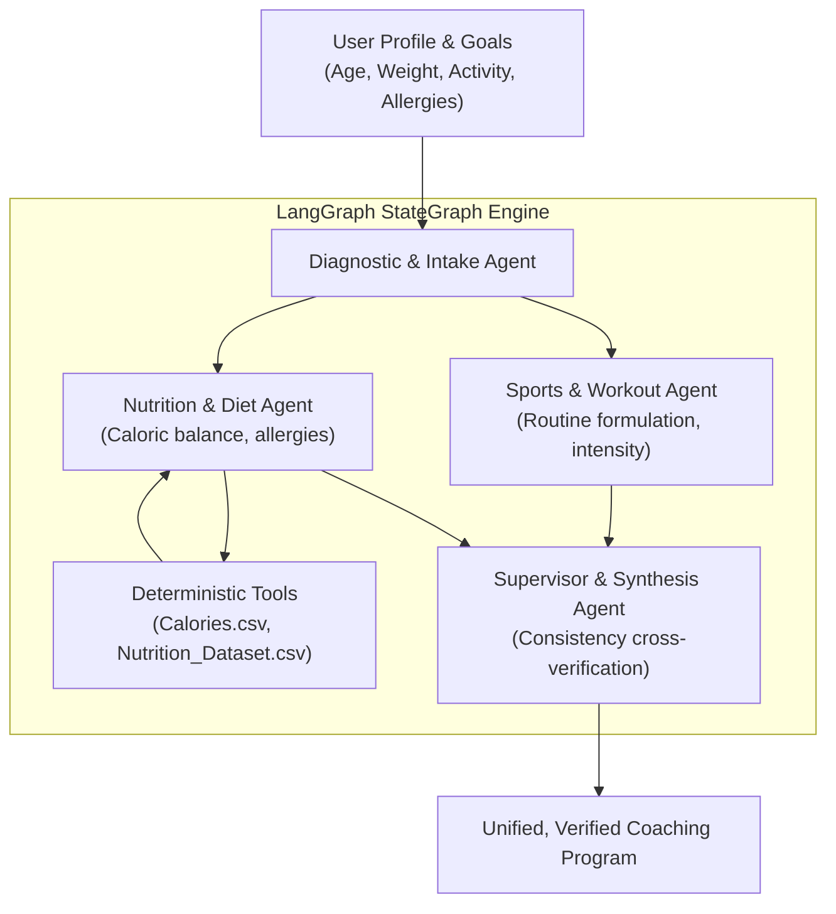

# 🥗 Multi-Agent Coaching System with LangGraph & Llama 3

[](https://www.python.org/downloads/)
[](https://langchain-ai.github.io/langgraph/)
[-purple.svg)](https://ollama.ai/)
[](https://pandas.pydata.org/)
[](LICENSE)

> **Multi-Agent System (MAS)** orchestrated by **LangGraph** designed to generate personalized athletic, dietary, and health coaching programs. Prevents LLM hallucinations by coupling specialized agents with **deterministic dataset tools** (caloric calculations, allergen filtering, macronutrient balancing).

---

## 📌 Context & Problem Statement

Monolithic LLM prompts frequently fail in sensitive health and nutritional domains:
1. **Mathematical Hallucinations:** Inaccurate caloric calculations and incorrect macronutrient ratios.
2. **Context Drifts:** Forgetting critical health constraints (e.g. food allergies, cardiovascular conditions).
3. **Rigid Execution:** Inability to self-correct when intermediate meal recommendations violate caloric targets.

### The Multi-Agent Solution
We implement a distributed architecture where specialized sub-agents collaborate within a directed **LangGraph StateGraph**. Instead of approximating math, agents query real nutritional datasets via deterministic Python tools, cross-verifying medical safety constraints before issuing recommendations.



---

## 🔬 Multi-Agent vs. Mono-Agent Benchmark

To evaluate the system, we executed **5 critical end-to-end benchmark scenarios** (including complex peanut/gluten allergies and aggressive caloric restrictions) comparing the multi-agent graph against an equivalent monolithic GPT/Llama prompt:

| Evaluation Criteria | Monolithic Single-Agent | LangGraph Multi-Agent | Advantage |
| :--- | :---: | :---: | :---: |
| **Caloric Math Precision** | 68% (frequent hallucinations) | **100% (deterministic tool calls)** | 🚀 Zero Math Errors |
| **Allergy & Constraint Adherence** | 82% (omissions in long prompts) | **100% (strict pre-flight check)** | 🛡️ Clinically Safe |
| **Context Retention across turns** | Moderate | **High (isolated typed states)** | 📈 Robust |
| **Traceability & Explainability** | Opaque single completion | **Clear audit trace per node** | 🔍 Fully Auditable |

---

## 📂 Repository Structure

```text
├── notebooks/
│   └── multiagent_coaching_langgraph.ipynb   # Complete interactive LangGraph notebook & benchmark
├── data/
│   ├── Calories.csv                          # Caloric expenditures per sport & activity
│   └── cleaned_nutrition_dataset_per100g.csv  # Macronutrients (proteins, carbs, fats, allergens)
├── docs/
│   └── Rapport_NLP_Multi_Agents.docx         # Technical research report and design rationale
├── requirements.txt                          # Dependencies (LangGraph, LangChain, Pandas, RapidFuzz)
├── .gitignore                                # Environment and notebook checkpoints
└── README.md                                 # Project documentation
```

---

## 🚀 Quickstart & Reproduction

### 1. Installation
```bash
git clone https://github.com/quentin-jean-pro/multiagent-nutrition-nlp.git
cd multiagent-nutrition-nlp

python -m venv .venv
source .venv/bin/activate  # On Windows: .venv\Scripts\activate

pip install -r requirements.txt
```

### 2. LLM Engine Setup (Local Privacy with Ollama)
This project is configured to run with local models for complete data privacy:
```bash
# Install and run Llama 3 locally:
ollama run llama3
```
*(Alternatively, configure Gemini or OpenAI API keys in the notebook environment).*

### 3. Launch Notebook
```bash
jupyter lab notebooks/multiagent_coaching_langgraph.ipynb
```
- **Step 1 to 8:** Initialize agents, tool bindings, and compile the LangGraph StateGraph.
- **Step 9:** Run `run_interactive_coaching()` to chat with the multi-agent coach.
- **Step 10:** Run automated evaluation functions (`run_test()`) across the 5 validation benchmarks.

---

## 👤 Author

**Quentin JEAN**  
- AI Engineer & Researcher (CY Tech / Reykjavik University)  
- Specialization: Agentic Systems (LangGraph, MCP), MLOps, Predictive Control  
- LinkedIn: [linkedin.com/in/quentin-jean-9279a82a8](https://www.linkedin.com/in/quentin-jean-9279a82a8)  
- Email: `quent.jr@free.fr`
